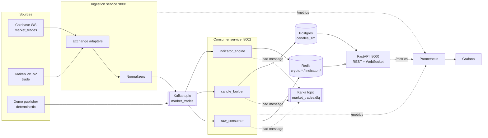
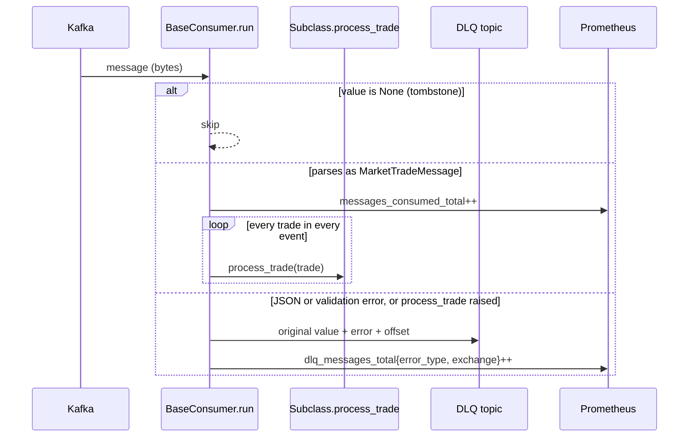

# Flux architecture

Flux turns live exchange trade feeds into two products: durable 1-minute OHLCV candles and low-latency streaming indicators. This document covers how data moves through the system, the guarantees each stage makes, and the trade-offs behind them.

## System overview



There are three long-running processes (ingestion, consumer, API) plus an optional demo publisher. They only share state through Kafka, Postgres and Redis, so each can be restarted or scaled on its own.

| Process | Entry point | Reads | Writes | Metrics port |
|---|---|---|---|---|
| Ingestion | `services/ingestion/main.py` | Exchange WebSockets | `market_trades` | 8001 |
| Consumer | `services/consumer/main.py` | `market_trades` | Postgres, Redis, `market_trades.dlq` | 8002 |
| API | `services/api/main.py` | Postgres, Redis | (none) | 8000 (`/metrics`) |
| Demo publisher | `scripts/demo_fallback_publisher.py` | (none) | `market_trades` | (none) |

## 1. Ingestion: one schema for every exchange

Each exchange gets an adapter (`services/ingestion/exchanges/`) that subclasses `BaseExchange`. An adapter owns three things: the WebSocket URL, the subscribe message, and a pure normalizer function that maps the exchange's payload to the shared `MarketTradeMessage` model in `services/market_data/models.py`.

```text
MarketTradeMessage
├── channel:   "market_trades"
├── exchange:  "coinbase" | "kraken" | "demo"
├── timestamp: datetime
└── events: [ Event { type, trades: [ Trade ] } ]

Trade { exchange, trade_id, product_id, price, size, side, time }
```

Keeping normalizers as pure functions (`normalizers.py`) means exchange quirks are unit-tested without a socket: Kraken's `BTC/USD` symbols and `qty` field are mapped to `BTC-USD` and `size`, sides are upper-cased, and messages with no trades are dropped before they reach Kafka.

Adding an exchange is a new adapter plus a normalizer and its test. Nothing downstream changes, because every consumer, table and Redis key is already keyed by `exchange`.

On startup the adapter creates `market_trades` and `market_trades.dlq` if they don't exist, then publishes each normalized message as JSON. `messages_published_total{exchange, topic}` counts what goes out.

## 2. Kafka fan-out with independent consumer groups

All trades land on a single topic. Each consumer subscribes with its own consumer group, so every group receives every message and keeps its own offsets:

| Consumer group | Class | Job |
|---|---|---|
| `raw_consumer` | `RawConsumer` | Last price and size per product into Redis |
| `candle_builder` | `TickerConsumer` | 1-minute OHLCV candles into Postgres |
| `indicator_engine` | `IndicatorEngineConsumer` | SMA, EMA and RSI per product into Redis |

The groups are isolated from each other. A slow Postgres write delays candles but not live indicators, and each group's lag is visible on its own in Grafana. All three run in one process today (`asyncio.gather` in `consumer/main.py`), but because they are separate groups they could be split into separate deployments with no code changes.

### The shared consumer loop

`BaseConsumer.run()` owns everything that isn't business logic:



Subclasses implement only `process_trade(trade)` and, optionally, the `on_start` and `on_stop` hooks. A background task samples `end_offset - position` per partition every 5 seconds into the `consumer_lag` gauge.

## 3. Dead letter queue

A message that fails to decode, fails schema validation, or makes `process_trade` raise is never retried in-line and never blocks the partition. It is wrapped and sent to `market_trades.dlq`:

```json
{
  "exchange": "kraken",
  "original_topic": "market_trades",
  "original_offset": 1042,
  "original_value": "{...raw payload...}",
  "error": "1 validation error for MarketTradeMessage ...",
  "error_type": "ValidationError",
  "failed_at": "2026-04-13T22:41:05+00:00"
}
```

The exchange label is recovered from the raw payload when possible, and falls back to `unknown`. The `DlqNonZero` alert fires on any DLQ traffic, because in a normalized pipeline any DLQ message means a schema drift or a bug.

## 4. Candle aggregation

`CandleAggregator` (`services/consumer/ticker_consumer.py`) keeps an in-memory buffer per `(exchange, product_id)` per minute bucket.

- **Bucketing** uses the trade's own timestamp, normalized to UTC and truncated to the minute. Processing time is never used, so a replayed or lagging stream still produces the correct candles.
- **Out-of-order trades** are handled inside a bucket: `open` is the price of the earliest trade time seen and `close` is the latest, regardless of arrival order. `high`, `low` and `volume` are order-independent.
- **Grace window.** A flush loop runs every second and writes a bucket only once `now >= bucket_end + grace_period` (5 seconds by default). This absorbs normal network jitter between the exchange and Kafka.
- **Late trades** that arrive after their bucket was flushed open a new buffer for that minute, but the insert uses `ON CONFLICT (exchange, product_id, timestamp) DO NOTHING`. The first written candle wins, which makes writes idempotent under redelivery.
- **Shutdown** flushes every open buffer (`flush_all`) before closing the database connection, so a clean restart doesn't lose the current minute.

```text
 22:40:00            22:41:00   22:41:05
    |------ bucket ------|--grace--|
    trades accumulate        flush -> INSERT ... ON CONFLICT DO NOTHING
```

Storage is a single table with a composite primary key:

```sql
candles_1m (exchange, product_id, timestamp, open, high, low, close, volume)
PRIMARY KEY (exchange, product_id, timestamp)
```

`Database.ensure_schema()` is idempotent and also migrates older single-exchange tables by back-filling `exchange = 'coinbase'`.

## 5. Streaming indicators

The indicator engine keeps one independent set of indicator objects per `exchange:product_id`, created lazily from registered templates:

```python
engine.add_indicator("sma_5", RunningSMA, window_size=5)
engine.add_indicator("rsi_14", RunningRSI, window_size=14)
engine.add_indicator("ema_12", RunningEMA, window_size=12)
```

Every indicator is O(1) per trade and holds bounded state:

| Indicator | Update rule | Warm-up behaviour |
|---|---|---|
| `RunningSMA` | Mean of a `deque(maxlen=n)` | Averages the partial window |
| `RunningEMA` | `ema += (price - ema) * 2/(n+1)` | Seeded with the SMA of the first `n` prices; returns the raw price until then |
| `RunningRSI` | Wilder smoothing of average gain and loss | Returns `None` until `n` price changes are seen; returns 100 when there are no losses |

Values are written to Redis with a single pipeline per trade under `indicator:{exchange}:{product_id}:{name}`. `None` values are skipped, so clients never read a half-warmed indicator.

## 6. Serving layer

The FastAPI app (`services/api/main.py`) opens one Postgres connection and one Redis client at startup (lifespan) and exposes:

| Route | Backed by | Notes |
|---|---|---|
| `GET /health` | (none) | Liveness |
| `GET /markets` | config | Supported exchanges, products, resolutions and example URLs |
| `GET /candles/{product}/{resolution}` | Postgres | `1m` only; other resolutions return 400; `limit <= 1000` |
| `WS /crypto/{product}` | Redis `crypto:*` and `indicator:*` | Price, size and indicators |
| `WS /indicators/{product}` | Redis `indicator:*` | Indicators only |

All routes take `?exchange=`. A small in-memory sliding-window limiter caps each client IP at `RATE_LIMIT_PER_MINUTE` on public paths, and `prometheus-fastapi-instrumentator` exports request rate, errors and latency.

## 7. Observability

| Metric | Type | Labels | Emitted by |
|---|---|---|---|
| `messages_published_total` | counter | exchange, topic | ingestion |
| `messages_consumed_total` | counter | consumer_group, topic, exchange | consumers |
| `dlq_messages_total` | counter | consumer_group, topic, error_type, exchange | consumers |
| `redis_writes_total` | counter | consumer_group, exchange, keyspace | raw and indicator consumers |
| `consumer_lag` | gauge | consumer_group, topic, partition | consumers |
| `http_*` | histogram, counter | handler, method, status | API |

Grafana is provisioned from `monitoring/grafana/` with a pipeline overview dashboard. Alert rules in `monitoring/alerts.yml` cover `ApiDown`, `DlqNonZero` and `ConsumerLagHigh` (more than 100 messages behind for 30 seconds).

## 8. Deployment

`docker-compose.prod.yaml` runs everything on one VPS from a single application image. Caddy terminates TLS for `API_DOMAIN` and is the only public listener. Kafka (KRaft, no ZooKeeper), Postgres, Redis, Prometheus and Grafana stay on the private Docker network. The `demo` publisher keeps the public API populated when exchange feeds are quiet.

## Delivery guarantees

| Stage | Guarantee |
|---|---|
| Exchange to Kafka | Best effort. A dropped WebSocket loses trades until it reconnects. |
| Kafka to consumers | At least once. Offsets auto-commit, so a crash can replay recent messages. |
| Candles in Postgres | Effectively once per minute per product, through `ON CONFLICT DO NOTHING`. |
| Indicators in Redis | Last write wins. A replay re-applies trades, so indicator state can drift slightly after a crash. |

## Known limitations and next steps

These are deliberate scope cuts or known gaps, listed so the trade-offs are explicit.

- **Ingestion reconnects are capped.** Adapters use the shared `retry_policy` (5 attempts with exponential backoff) around the whole `run()` call, so after five disconnects over the life of the process an adapter stops. The fix is an outer reconnect loop that resets the attempt count after a healthy connection.
- **Single partition.** Topics are created with one partition and replication factor 1. That is fine for three products, but horizontal scaling of a consumer group needs more partitions keyed by `exchange:product_id`, so per-product ordering is kept.
- **Aggregator state is in memory.** If the consumer crashes (not a clean stop), the open minute is rebuilt from Kafka replay only as far back as the last committed offset. Committing offsets manually after a successful flush would close that gap.
- **WebSocket fan-out polls Redis.** Each client scans Redis every 50 ms. Redis pub/sub or a shared broadcaster task would make the cost per client constant.
- **Rate limiter is per process.** It lives in memory, which is correct for one API replica. Several replicas would need a Redis-backed limiter.
- **Only 1-minute candles.** Higher resolutions could be rolled up from `candles_1m` in SQL or with a continuous aggregate.

## Testing strategy

Unit tests in `tests/` cover the logic that decides correctness, without needing Kafka, Postgres or Redis:

- Exchange normalizers for Coinbase and Kraken, mapped to the shared schema
- Candle bucketing, out-of-order handling, the grace window and the late-trade path
- Indicator math checked against hand-computed SMA, EMA and Wilder RSI values
- The `BaseConsumer.run` loop: trade fan-out, DLQ routing for bad JSON and bad schema, tombstones, and lifecycle hooks
- Indicator engine isolation per exchange and product, and skipping warm-up values
- DLQ envelope shape, consumer lag calculation, API routes and config parsing

End-to-end behaviour is covered by `make smoke` (`scripts/local_integration_smoke.py`), which runs against the docker compose stack. It publishes backdated trades, checks persisted candles and API responses, forces a DLQ increment, and confirms Prometheus targets are up.
